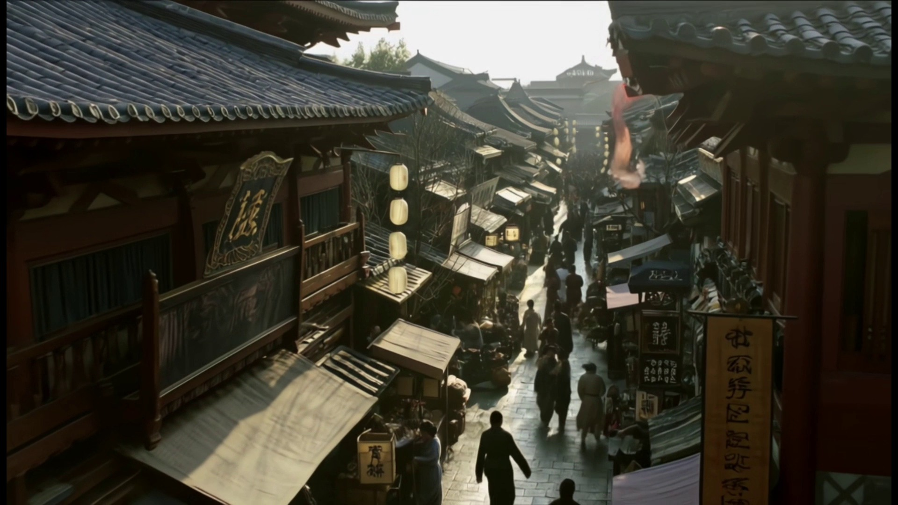
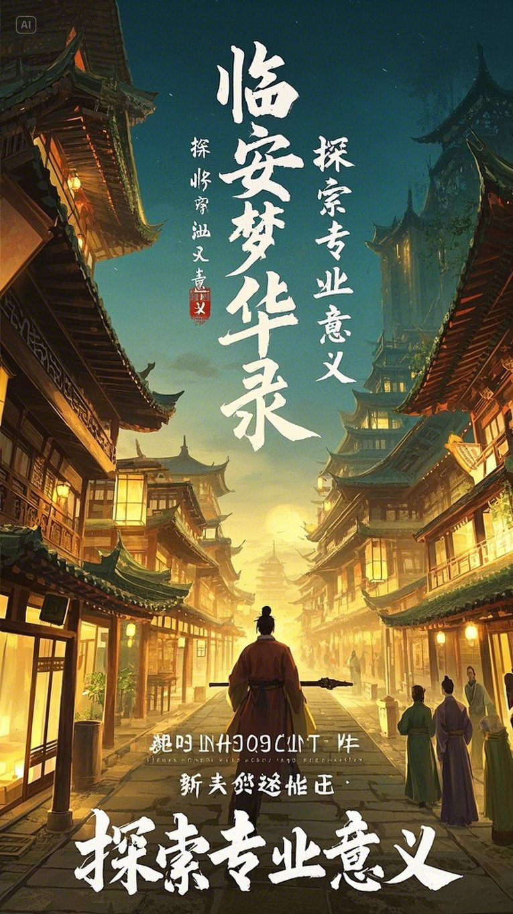
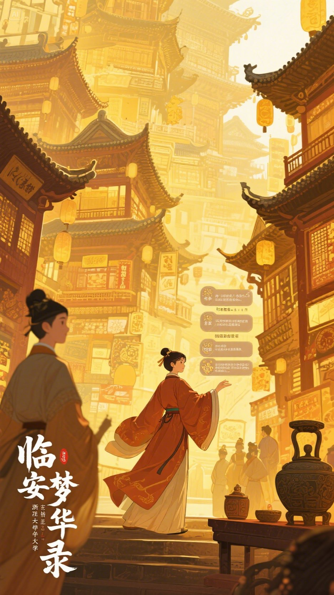
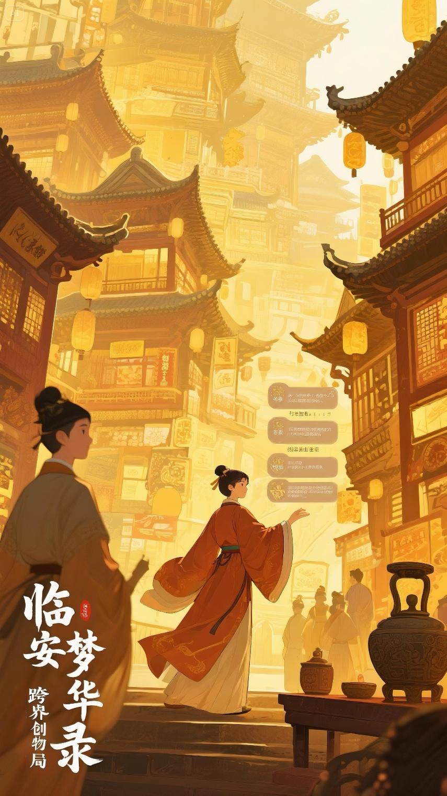

# 《临安梦华录》｜AIGC 多模态内容产品

**用任务驱动的穿越叙事，把宋韵文化转化为一段可观看、可理解的短视频体验。**

我担任四人跨专业团队的项目负责人，将文化传播选题拆解为目标受众、叙事体验和可交付场景，参与生成工具选型与内容迭代，推动任务分工、质量检查和阶段交付。团队以 **AI 图像／视频生成、AI 生成配乐与人工剪辑**完成约 **2 分 04 秒**的短片，并沉淀了脚本、Prompt 语料和多轮 Demo。

`2025.03—2025.06` · `浙江大学跨专业项目` · `项目负责人：刘思嫒`

`需求拆解与优先级` `MVP 定义` `叙事体验设计` `AI 能力评估` `Prompt Engineering` `人工质量验收` `跨专业协作`

## 先看作品

**[▶ 查看完整视频（含音频，约 2:04）](assets/linan-demo.mp4)** · [下载视频](assets/linan-demo.mp4?raw=true)

视频采用“现代学生进入南宋临安”的叙事框架，将市井生活、点茶与太学场景组织进任务进程。这里展示的是完成剪辑的线性视频，任务提示承担叙事引导作用。

| 项目要素 | 内容 |
| --- | --- |
| 目标受众 | 对杭州、宋韵文化和传统绘画感兴趣的高校师生及年轻观众 |
| 使用场景 | 校园文化传播、项目展映；文博导览与研学内容是后续探索方向 |
| 核心交付 | AIGC 短片、宣传海报、脚本、Prompt 语料和阶段汇报 |
| 团队构成 | 机械工程、工业设计、古典文献学背景，共 4 人 |
| 我的重点贡献 | 产品方案组织、任务机制构思、海报工具选型与生成、团队推进和展示材料整合 |

### 项目时间与技术背景

**这是完成于 2025 年春季至初夏的 AIGC 探索项目，视频保留当时的制作效果。** 团队使用即梦、LiblibAI、可灵、Midjourney 等图像与视频生成工具，配乐由 AI 生成，片段筛选、叙事衔接和最终剪辑由成员完成。在实际制作中，复杂动作、运镜稳定性和跨片段风格一致性仍需要反复尝试与人工调整。

作为时间参照，字节跳动于 **2025 年 6 月 11 日**发布 Seedance 1.0 的官方介绍与技术报告文章，**2026 年 2 月 12 日**正式发布 Seedance 2.0。项目主要探索发生在 2025 年 3—5 月，因此应按当时实际使用的工具和制作条件理解成片。[Seedance 1.0 官方文章](https://seed.bytedance.com/zh/blog/tech-report-of-seedance-1-0-is-now-publicly-available) · [Seedance 2.0 官方公告](https://seed.bytedance.com/zh/blog/official-launch-of-seedance-2-0)

今天回看，局部画面与转场仍显粗糙；但在四人跨专业团队的课程项目范围内，作品已完成**叙事设计、图像与视频生成、AI 配乐、人工剪辑和展示交付**，形成较完整的视听作品与迭代过程。这也是本案例重点展示的产品实践价值。

**项目采用“人主导、AI 辅助”的制作方式。** 2025 年春季，Claude Code、Codex 等编程 Agent 正处于早期推出或研究预览阶段。团队的实际工作流以成员主动操作生成工具为主，选题策划、脚本与任务设计、Prompt 调整、素材筛选、跨工具衔接和最终剪辑均主要由人组织与完成。项目的产品实践重点，是在工具能力与制作资源约束下，通过人的判断和协作推进完整交付。[技术背景与官方时间记录](docs/technology-context.md)

## 1. 产品定义：让观众有理由继续看下去

早期方案以古画动态化和临安景色展示为主。它能提供视觉吸引力，但仅把漂亮片段拼在一起，难以解释主角为什么穿越、为什么进入下一个场景，以及如何回到现实。

我参与将这个问题拆为两个相互关联的设计目标：

- **观众侧：**用主角目标和任务提示连接文化场景，让观众跟得上故事。
- **生产侧：**把脚本拆成可分工、可生成、可检查的片段，降低多人使用不同工具时的衔接难度。

团队最终围绕“穿越＋任务驱动”组织内容，将市井、点茶、太学作为核心场景。需求判断来自选题研究、同类文化内容分析，以及阶段展示中的教师反馈和团队复盘。

**MVP 的交付边界：**完成一条具备开场、场景推进和回归结尾的视频，验证叙事方案与 AIGC 制作路径。交互分支、自动化生产平台和商业推广属于进一步探索。

→ [产品需求说明：场景、范围与验收思路](docs/product-brief.md)

## 2. 开发流程：围绕交付组织 AIGC 生产

**选题与内容研究 → 叙事及场景拆解 → 工具试用 → 参考图与 Prompt → 片段生成 → 人工检查 → 剪辑整合 → 展示复盘**

这套工作流由团队使用多个生成工具、人工筛选和剪辑衔接完成，AI 生成配乐作为独立音频素材进入后期整合。人的判断贯穿场景取舍、生成结果检查和成片验收。

| 阶段 | 关键动作与取舍 | 留存产出 |
| --- | --- | --- |
| 选题探索，3 月上旬 | 比较《山海经》、南宋临安、丝路等方向，聚焦与杭州及校园文化关联更强的临安题材 | 3.13 选题汇报 |
| 方案明确，3 月中旬 | 定义受众与内容方向，拆分背景、创新点、视频构思及成员任务 | 3.18 讨论与分工、3.20 项目介绍 |
| Demo 验证，3 月下旬至 4 月初 | 尝试古画动态化、人物与场景生成，通过展示暴露画风和叙事衔接问题 | 3.27 Demo、4.7 视频与阶段总结 |
| 内容迭代，4—5 月 | 引入任务提示，补充穿越逻辑，调整人物描述、参考图和生成策略 | 脚本 1.0、4.24／4.28／5.15 汇报 |
| 成片交付，6 月 | 汇总镜头、剪辑与声音，完成视频和最终答辩展示 | 《临安梦华录》成片与最终展示 |

## 3. 关键决策：工具能力如何影响产品方案

### 按任务选择工具

在海报制作中，我试用了可画、Midjourney 和即梦，比较插画表现与中文标题生成效果。该轮实践中，Midjourney 的插画表现较好，中文文字仍需修正；即梦更适合这次包含中文标题的海报任务，因此成为我后续制作与文字迭代的主要工具。

团队在场景制作中还尝试了 **DeepSeek 辅助提示词、LiblibAI 图像生成、可灵图生视频**等组合。选型依据是当前片段能否被有效生成和编辑，而非统一使用同一个工具完成所有步骤。

| 制作环节 | 工具／方式 | 在本项目中的用途 |
| --- | --- | --- |
| 创意与提示词辅助 | DeepSeek 等 | 将场景意图整理为人物、动作及环境描述 |
| 图像与海报探索 | 即梦、LiblibAI、Midjourney；另试用可画 | 生成视觉素材，比较画面表现与中文标题效果 |
| 动态片段生成 | 即梦、可灵等 | 尝试场景动态化、人物动作与图生视频 |
| 配乐 | AI 音乐生成 | 为成片提供配乐素材 |
| 最终整合 | 人工剪辑 | 完成镜头组织、字幕、转场与声音衔接 |

**选型关注点：**意图能否被正确执行、生成结果是否稳定、文字与风格是否适配，以及素材能否进入后续剪辑。上述比较来自实际任务中的定性试用。

<table>
  <tr>
    <td></td>
    <td></td>
    <td></td>
  </tr>
</table>

*项目原始海报探索样例。*

### 用结构化 Prompt 降低表达歧义

项目留存的 Prompt 语料框架为：

> 风格＋拍摄方式＋时代＋人物形象＋人物动作＋环境＋色彩／光线／情感基调

“古代人物”“穿越”等宽泛描述，容易产生服饰、动作或场景偏差。团队在迭代中逐步补充人物服装、主体动作、参考画面与风格描述，并检查生成结果是否适合进入后续剪辑。

→ [Prompt 结构与使用示例](docs/prompt-patterns.md)

## 4. Bad Case：从生成结果反推改进动作

| 实际遇到的问题 | 产品判断 | 迭代动作与结果边界 |
| --- | --- | --- |
| 穿越和景色片段简单拼接，情节张力不足 | 需要明确的目标串联场景 | 引入任务机制，继续调整任务与剧情之间的关系 |
| 让人物“被古画吸进去”，却生成人物蹲下 | 复杂动作描述超出当次生成的稳定表现 | 修改人物、动作与场景描述；在脚本中保留简化转场的备选方案 |
| 古画纵深运镜退化为平移，复杂运镜出现抖动 | 提示词意图与生成能力存在差距 | 尝试旋转、航拍等方式，记录其稳定性问题，保留人工筛选环节 |
| 不同成员产出的画风不统一 | 局部画面质量不等于整体观看体验 | 对齐风格方向，调整参考图与提示词，并在合成前检查片段；成片仍有风格切换 |
| 海报中文标题不符合预期 | 必须将文字可读性纳入工具选型 | 在这次任务中选择即梦，并继续修正标题文字 |

→ [工作流与详细迭代复盘](docs/workflow-and-cases.md)

## 5. 我的产品职责与技能实践

作为项目负责人，我把较开放的创作目标整理为具体任务，明确素材提交与剪辑的先后关系，并推动多轮展示及修改。

| 产品技能 | 我的具体实践 | 对交付的作用 |
| --- | --- | --- |
| 需求分析与场景拆解 | 参与受众和同类内容分析，将文化传播目标落实到市井、点茶、太学等场景 | 让抽象选题变成可制作、可讨论的任务 |
| MVP 与范围管理 | 围绕线性短片组织交付，推动核心场景和完整故事优先落地 | 让团队围绕明确的交付物协作 |
| 用户体验与流程设计 | 提出以任务系统连接场景的构思，细化主角目标、任务提示与回归逻辑 | 改善片段之间的叙事关系 |
| AI 能力评估与工具选型 | 直接比较可画、Midjourney、即梦的海报效果，围绕中文标题需求选择工具 | 将模型表现转化为具体的产品取舍 |
| Prompt 设计与质量判断 | 迭代海报指令和文字，对效果不佳或风格明显不符的素材提出修改要求 | 把“是否可交付”落实为可讨论的问题 |
| 项目管理与协作交付 | 拆分成员任务，规定片段提交、剪辑交付节点，整合汇报材料 | 管理上下游依赖，推进阶段 Demo 与最终展示 |

以上能力以原始项目实践为基础，需求优先级与验收维度在配套文档中进一步结构化。下一步可补充生成可用率、返工成本与观众理解度等指标，使定性判断逐步具备数据依据。

视频内容是团队共同成果。其他成员分别承担穿越片段、古画动态化、相关场景生成、文案与后期剪辑等工作。

## 6. 交付结果与产品复盘

本项目完成了 **约 2:04 的完整视频、AI 生成配乐、海报探索、脚本和 Prompt 语料，以及覆盖 3—6 月的多轮展示材料**。它验证了小型跨专业团队组织 AIGC 内容制作与迭代交付的可行路径。

我的核心收获是：**先定义场景在故事里的作用，再选择工具和生成策略；把生成结果放回完整观看流程，才能判断它是否可用。**

后续可进一步验证两个方向：一是以小样本观众测试检查任务线理解和文化信息记忆；二是记录镜头生成次数、有效素材比例及返工原因，让工具选型和制作效率有可比较的数据基础。

当前案例以制作与交付成果为主，尚未建立对外投放的观看、转化或商业收益数据。

---

**进一步阅读**

- [产品需求说明](docs/product-brief.md)
- [工作流与迭代复盘](docs/workflow-and-cases.md)
- [Prompt 结构与示例](docs/prompt-patterns.md)
- [团队与素材说明](docs/credits.md)
- [项目技术背景与时间核查](docs/technology-context.md)

*本案例依据项目原始脚本、分工、汇报、成片及项目负责人补充说明整理。需求说明中的结构化验收框架属于作品集复盘沉淀。*
